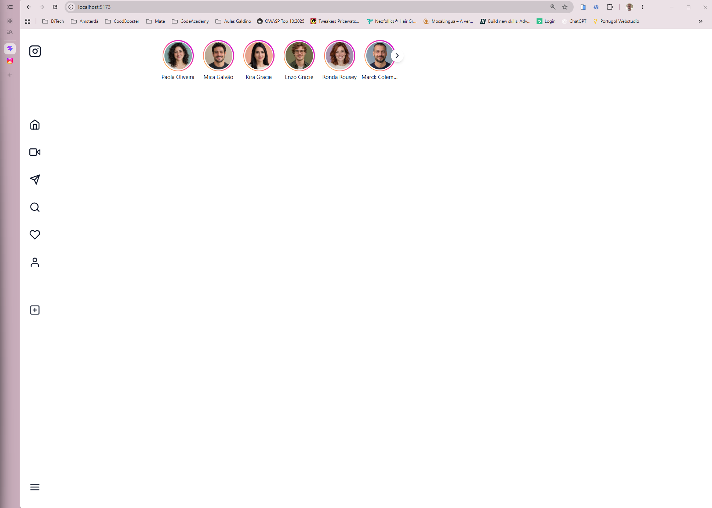

# React + Vite

This template provides a minimal setup to get React working in Vite with HMR and some ESLint rules.

Currently, two official plugins are available:

- [@vitejs/plugin-react](https://github.com/vitejs/vite-plugin-react/blob/main/packages/plugin-react) uses [Oxc](https://oxc.rs)
- [@vitejs/plugin-react-swc](https://github.com/vitejs/vite-plugin-react/blob/main/packages/plugin-react-swc) uses [SWC](https://swc.rs/)

## React Compiler

The React Compiler is not enabled on this template because of its impact on dev & build performances. To add it, see [this documentation](https://react.dev/learn/react-compiler/installation).

## Expanding the ESLint configuration

If you are developing a production application, we recommend using TypeScript with type-aware lint rules enabled. Check out the [TS template](https://github.com/vitejs/vite/tree/main/packages/create-vite/template-react-ts) for information on how to integrate TypeScript and [`typescript-eslint`](https://typescript-eslint.io) in your project.

projeto de nivelamento da escola DiTech através da simuilação da página do instagram.

o projeto está utlizando:

- vite como o provededor/servidor da aplicação com o modelo React;
- da mesma forma foi instalado o Tailwind para a formtação das páginas;
- dados mocados em arquivo .js;

para executar o projeto, no powershell (terminal do vs code) deve se estar na pasta onde o vite foi instalado e rodar o comando de exexcução:

- "..\projetos\ditech\Nivelamento_Instagram>npm run dev; isso abrirá a aplicação em uma janela do browser, normalmente no endereço: http://localhost:5173/ ou outra porta se a 5173 estiver ocupada;

Aprendizado até o momento:

- olhar para o designer e exercitar o ato de enxergar em primeiro lugar a estrutura que determinada página irá possuir e escrever a estrutura básica sa ser preenchida passo a passo com as informações necessárias;
- entender quando podemos ter um componente ou quando será realmente uma página... ex:
  - o menu pode ser um componente, pois apesar de que em nosso caso, ele não será reutilizado, ele, por si só expressa uma idéia de todo, ele tem uma funcionalidade que somente ele executará... então, facilita na leitura do código estar em um arquivo exclusivo, compartimentando o código.;
  - os stories, os posts, o usuário logado e as sugestões de usuários serem componentes pois podemos criar um componente apenas e reutilizar o mesmo diversas vezes para cada um desses itens
- entender justamente a complexidade que essa componentização trás, atá que (eu espero que sim) comecemos a enxergar mais facilmente essa construção, pois essa maior complexidade permite diminuir em muito a escrita de código e o tempo de codificação
- voltar (no meu caso) a desenvolver a lógica e de forma diferente, já quie precisamos imaginar os compoentes que precisaremos construir para poder fazer uma página funcionar... antes, utilizava um componente existente, agora, desenveolvo o componente que precisarei utilizar em determinada página
